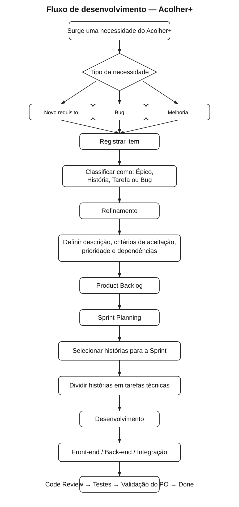
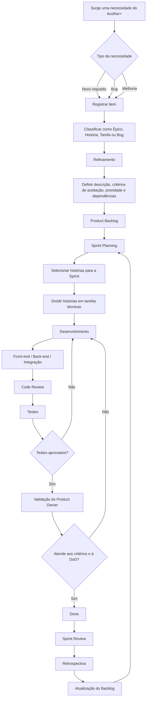

# Processo de Desenvolvimento — Equipe Ampliada

Este documento descreve uma proposta de organização do fluxo de trabalho do **Acolher+** considerando uma equipe maior. O objetivo é padronizar como necessidades, histórias, tarefas e bugs percorrem o projeto desde a identificação até a conclusão.

---

## 1. Fluxo do processo de desenvolvimento

O processo representa o caminho de uma demanda desde o momento em que surge até sua conclusão. Requisitos, melhorias e bugs são registrados, refinados, priorizados e, quando selecionados para uma Sprint, passam por desenvolvimento, revisão, testes e validação.

### Visualização em imagem

Para facilitar a visualização em dispositivos móveis, o fluxograma também está disponível em formato de imagem:

### Versão em Mermaid

O processo é cíclico. Itens que não forem selecionados permanecem no **Product Backlog** para refinamento e priorização futura. Itens reprovados na revisão, nos testes ou na validação retornam ao desenvolvimento antes de serem considerados concluídos.

---

## 2. Organização do quadro

Para uma equipe maior, o fluxo de **histórias e tarefas** pode ser separado do fluxo de **bugs**, facilitando a visualização do estado de cada tipo de trabalho.

### 2.1 Histórias e tarefas

| Status | Significado |
|---|---|
| **Backlog** | Item identificado e registrado, mas ainda não preparado para desenvolvimento. |
| **Refinamento** | Descrição, critérios, prioridade, estimativa e dependências estão sendo definidos. |
| **Pronto para Sprint** | Item refinado e apto a ser selecionado no Sprint Planning. |
| **To Do** | Item selecionado para a Sprint e pronto para ser iniciado. |
| **Doing** | Implementação em andamento. |
| **Code Review** | Implementação concluída e aguardando revisão técnica. |
| **Testes** | Item sendo verificado de acordo com os critérios de aceitação. |
| **Validação do PO** | Funcionalidade aprovada tecnicamente e aguardando validação do Product Owner. |
| **Done** | Critérios de aceitação e Definition of Done atendidos. |

**Fluxo principal:**

**Backlog → Refinamento → Pronto para Sprint → To Do → Doing → Code Review → Testes → Validação do PO → Done**

Caso haja problema em **Code Review**, **Testes** ou **Validação do PO**, o item retorna para **Doing**.

### 2.2 Bugs

| Status | Significado |
|---|---|
| **Novo** | Problema identificado e registrado. |
| **Triagem** | O bug é reproduzido, avaliado e tem impacto e prioridade definidos. |
| **Pronto para correção** | Problema confirmado e suficientemente descrito para desenvolvimento. |
| **Em correção** | Correção sendo implementada. |
| **Em teste** | Correção sendo testada, incluindo regressão quando necessário. |
| **Fechado** | Correção validada e problema considerado resolvido. |

**Fluxo de bugs:**

**Novo → Triagem → Pronto para correção → Em correção → Em teste → Fechado**

Caso o teste falhe, o bug retorna para **Em correção**.

Os bugs não precisam obrigatoriamente seguir o mesmo fluxo de uma User Story. A triagem permite definir urgência, impacto e o momento adequado para correção. Bugs críticos podem ser priorizados imediatamente, enquanto bugs de baixo impacto podem permanecer aguardando planejamento.
