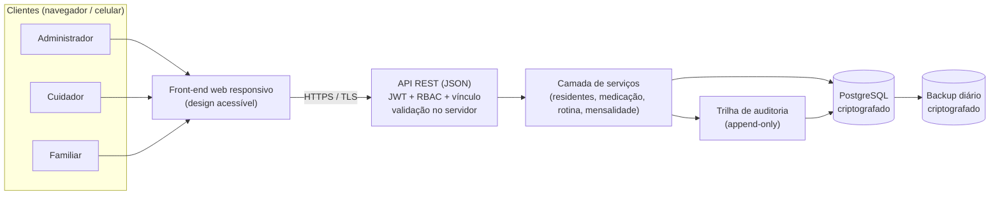

# Acolher+ — Requisitos Não Funcionais e Decisões Arquiteturais

> Sistema de Gestão para Instituições de Longa Permanência para Idosos (ILPIs)
> Etapa: **Requisitos Não Funcionais (RNFs) e Decisões Arquiteturais**

## 1. Integrantes do grupo

| # | Nome |
|---|------|
| 1 | Danylo Falcão |
| 2 | Heloisa Lira |
| 3 | Mileni Savily |
| 4 | Sandrine Azevedo |

---

## 2. Contexto

O **Acolher+** centraliza o cadastro de residentes, o controle de medicação, o registro da rotina de cuidados e a comunicação com familiares em lares de idosos. O backlog do projeto, mantido no GitHub Projects, define **25 histórias de usuário** em 6 épicos, para três perfis: **Administrador**, **Cuidador** e **Familiar**. Neste documento, cada história aparece com o ID do backlog (por exemplo, E03-US03) e o número da issue (por exemplo, #39).

Dois fatores do domínio pesam mais que os demais sobre a arquitetura:

1. **Dados sensíveis de saúde** (medicamentos, doses, observações de rotina), sujeitos à LGPD. Isso exige segurança, rastreabilidade e integridade.
2. **Uso em campo por cuidadores** com pouco tempo e, muitas vezes, pouca familiaridade com tecnologia, geralmente pelo celular. Isso exige simplicidade, resposta rápida e responsividade.

> **Nota sobre os valores:** as metas numéricas dos RNFs (tempos, percentuais, limites) são **metas de referência adotadas para a simulação do projeto**, coerentes com um MVP de ILPI de pequeno e médio porte. O banco de dados adotado pelo grupo é o **PostgreSQL** e a autenticação por **JWT** já consta no backlog (E06-US03).

---

## 3. Requisitos Não Funcionais levantados e classificados

A classificação segue as características de qualidade da norma **ISO/IEC 25010**. A prioridade segue o mesmo raciocínio MoSCoW do backlog.

### 3.1 Desempenho (eficiência de desempenho)

| ID | Requisito | Meta mensurável | Prioridade | Histórias relacionadas |
|----|-----------|-----------------|------------|------------------------|
| RNF-01 | Tempo de resposta de consultas e telas | 95% das requisições em até **2 s**, com 50 usuários simultâneos | Must | E01-US02, E01-US03, E02-US03, E03-US02, E03-US04, E04-US04, E05-US01, E05-US02, E05-US03 |
| RNF-02 | Registro imediato das ações do cuidador | Confirmação de dose, higiene, refeição ou observação em até **1 s** percebido | Must | E03-US03, E04-US01, E04-US02, E04-US03 |
| RNF-03 | Capacidade e escalabilidade | Suportar **200 residentes** e **100 usuários** cadastrados sem degradação, com crescimento por escala vertical | Should | E02-US03, E03-US04, E04-US04, E06-US01 |

### 3.2 Segurança

| ID | Requisito | Meta mensurável | Prioridade | Histórias relacionadas |
|----|-----------|-----------------|------------|------------------------|
| RNF-04 | Autenticação segura | Senhas armazenadas apenas com hash forte e salt (bcrypt ou Argon2). Token JWT com expiração curta. Bloqueio temporário após **5** tentativas inválidas | Must | E01-US01, E01-US02, E01-US03, E06-US03 |
| RNF-05 | Controle de acesso por perfil e por vínculo | Autorização no **servidor** em 100% das rotas protegidas. Familiar acessa **somente** dados do residente autorizado, em modo leitura | Must | E01-US02, E01-US03, E01-US04, E02-US01, E02-US02, E02-US04, E02-US05, E03-US01, E03-US04, E04-US04, E05-US01, E05-US02, E05-US03, E06-US02, E06-US03 |
| RNF-06 | Proteção de dados em trânsito e em repouso | Todo tráfego via **HTTPS (TLS 1.2+)**. Banco e backups criptografados | Must | E01-US01, E01-US02, E01-US03, E06-US01, E06-US03, E06-US04 |
| RNF-07 | Conformidade com a LGPD | Coleta mínima de dados, finalidade declarada, dados de saúde tratados como sensíveis, consentimento do responsável registrado | Must | E01-US01, E01-US04, E02-US01, E02-US02, E02-US04, E03-US01, E04-US03, E05-US01, E05-US02, E05-US03 |
| RNF-08 | Rastreabilidade e imutabilidade dos registros | Registros de dose e de rotina não são excluídos. Correções entram como complemento. Toda ação sensível guarda usuário e data/hora | Must | E02-US02, E02-US05, E03-US03, E03-US04, E04-US01, E04-US02, E04-US03, E04-US04 |
| RNF-09 | Validação de entrada e proteção contra injeção | Validação no servidor de 100% dos campos recebidos, consultas parametrizadas e nenhuma vulnerabilidade crítica do OWASP Top 10 nos testes | Must | E01-US01, E02-US01, E02-US02, E02-US04, E02-US05, E03-US01, E04-US03, E06-US02, E06-US04 |

### 3.3 Usabilidade

| ID | Requisito | Meta mensurável | Prioridade | Histórias relacionadas |
|----|-----------|-----------------|------------|------------------------|
| RNF-10 | Simplicidade para o cuidador | Registrar uma dose em no máximo **3 toques/cliques** a partir da tela inicial do Cuidador | Must | E01-US03, E03-US02, E03-US03, E04-US01, E04-US02, E04-US03 |
| RNF-11 | Responsividade e compatibilidade | Uso adequado em celular, tablet e desktop, nas **2 últimas versões** de Chrome, Firefox, Edge e Safari | Must | E02-US03, E03-US02, E03-US03, E04-US01, E04-US02, E04-US03, E05-US01, E05-US02, E05-US03, E05-US04 |
| RNF-12 | Acessibilidade | Conformidade com **WCAG 2.1 nível AA**: contraste mínimo 4,5:1, fonte base de pelo menos 16 px, alvos de toque de pelo menos 44 px | Should | E02-US01, E05-US01, E05-US02, E05-US03, E05-US04 |
| RNF-13 | Mensagens e validações claras | Validação em tempo real, mensagens em português, sem jargão técnico, indicando o campo e como corrigir. Erros de integração informados ao usuário | Should | E01-US01, E01-US02, E01-US03, E02-US01, E02-US02, E02-US05, E03-US01, E06-US04 |

### 3.4 Confiabilidade e disponibilidade

| ID | Requisito | Meta mensurável | Prioridade | Histórias relacionadas |
|----|-----------|-----------------|------------|------------------------|
| RNF-14 | Disponibilidade | **99%** mensal, com manutenções programadas fora dos horários de pico de medicação | Should | E03-US02, E03-US03, E05-US01, E06-US02 |
| RNF-15 | Backup e recuperação | Backup diário automático, com perda máxima de dados (RPO) de **24 h** e tempo de restauração (RTO) de até **4 h** | Should | E03-US03, E04-US01, E06-US01 |

### 3.5 Manutenibilidade, integridade e interoperabilidade

| ID | Requisito | Meta mensurável | Prioridade | Histórias relacionadas |
|----|-----------|-----------------|------------|------------------------|
| RNF-16 | Manutenibilidade | Código em camadas com baixo acoplamento. Cobertura de testes de pelo menos **70%** nas regras críticas (medicação, permissões) | Should | E06-US01, E06-US02, E06-US03, E06-US04 |
| RNF-17 | Integridade dos dados | Chaves primárias e estrangeiras definidas, campos obrigatórios `NOT NULL`, operações compostas em transação. Zero registros órfãos | Must | E02-US01, E02-US02, E02-US04, E02-US05, E03-US01, E03-US03, E04-US01, E04-US02, E04-US03, E06-US01 |
| RNF-18 | Interoperabilidade front-end e back-end | API REST com JSON, contrato de rotas documentado (OpenAPI) e códigos HTTP padronizados | Should | E06-US02, E06-US04 |

**Resumo:** 18 RNFs, sendo 3 de desempenho, 6 de segurança, 4 de usabilidade, 2 de confiabilidade e 3 de manutenibilidade, integridade e interoperabilidade.

---

## 4. Decisões arquiteturais

Cada decisão segue o formato **requisito → decisão → solução proposta**.

### Visão geral da solução

---

### AD-01: Aplicação web responsiva, com opção de PWA

- **Motiva-se por:** RNF-10, RNF-11, RNF-12
- **Decisão:** Um único front-end web responsivo (mobile-first), instalável como PWA, em vez de aplicativos nativos separados.
- **Justificativa:** Cuidadores usam celular durante o plantão e Familiares acessam de qualquer dispositivo. Um só código reduz custo e prazo do MVP, e a atualização chega a todos sem instalação manual.
- **Alternativa descartada:** Apps nativos Android e iOS, por exigirem duas bases de código e publicação em lojas, o que é desproporcional para um projeto de extensão.
- **Consequência:** Funcionalidades nativas avançadas ficam limitadas ao suporte de PWA do dispositivo. Para o MVP o impacto é aceitável.
- **Histórias:** E03-US02, E03-US03, E04-US01, E04-US02, E04-US03, E05-US01, E05-US02

### AD-02: Monólito modular em camadas com API REST

- **Motiva-se por:** RNF-01, RNF-14, RNF-16, RNF-18
- **Decisão:** Back-end único, organizado em módulos (usuários, residentes, medicação, rotina, mensalidade) e em camadas (rotas, serviço, repositório), expondo uma API REST em JSON com contrato documentado em OpenAPI.
- **Justificativa:** Equipe pequena e escopo de MVP não justificam microsserviços, que trariam complexidade operacional e latência de rede. Os módulos isolados permitem evoluir partes do sistema, como a mensalidade, sem reescrever o núcleo. O contrato documentado deixa front-end e back-end evoluírem em paralelo (E06-US02, E06-US04).
- **Alternativa descartada:** Microsserviços, pelo custo de orquestração, monitoramento distribuído e consistência de dados, sem benefício para 200 residentes.
- **Consequência:** Escalar exige replicar a aplicação inteira. É suficiente para a capacidade definida no RNF-03.
- **Histórias:** E01-US02, E01-US03, E06-US02, E06-US04

### AD-03: Banco de dados relacional PostgreSQL com transações

- **Motiva-se por:** RNF-03, RNF-08, RNF-15, RNF-17
- **Decisão:** Banco relacional **PostgreSQL**, escolhido pelo grupo, com chaves estrangeiras, restrições `NOT NULL`, índices e transações ACID para operações compostas.
- **Justificativa:** O domínio é altamente relacional (usuário, idoso, contato de emergência, medicamento, dose, rotina, mensalidade) e a E06-US01 exige estrutura e relacionamentos definidos. Regras como "um residente com apenas um registro válido" e "ao menos um contato de emergência" (E02-US01, E02-US02, E02-US04) são garantidas por restrições do próprio banco, não só pela aplicação.
- **Alternativa descartada:** Banco NoSQL de documentos, por dificultar a garantia de integridade referencial entre residentes, contatos, medicações e rotinas.
- **Consequência:** Mudanças de esquema exigem migrações versionadas, que passam a fazer parte do processo de entrega.
- **Histórias:** E02-US01, E02-US04, E03-US01, E03-US03, E06-US01

### AD-04: Autenticação via JWT com hash forte e bloqueio por tentativas

- **Motiva-se por:** RNF-04
- **Decisão:** Login por e-mail e senha, hash bcrypt ou Argon2 com salt, emissão de token **JWT** com expiração curta, exigência do token em todas as rotas protegidas e bloqueio temporário após 5 tentativas inválidas.
- **Justificativa:** O JWT já é o requisito da E06-US03 e funciona bem com uma API REST sem estado, usada por navegadores e celulares. O hash forte evita exposição de senhas em caso de vazamento, e o bloqueio mitiga força bruta nos logins de Administrador e Cuidador (E01-US02, E01-US03).
- **Alternativa descartada:** Armazenar senha com hash simples ou reversível, por não oferecer resistência a ataques de dicionário. Sessão em memória do servidor, por dificultar a replicação da aplicação.
- **Consequência:** Tokens não podem ser revogados antes de expirar. Por isso a expiração é curta e as ações sensíveis conferem o perfil a cada requisição.
- **Histórias:** E01-US01, E01-US02, E01-US03, E06-US03

### AD-05: Autorização por perfil (RBAC) e por vínculo, aplicada no servidor

- **Motiva-se por:** RNF-05, RNF-07
- **Decisão:** Três papéis fixos (Administrador, Cuidador, Familiar) verificados por middleware em **todas** as rotas protegidas. Para o Familiar, uma regra adicional filtra os dados pelo residente ao qual ele tem acesso, em modo somente leitura.
- **Justificativa:** Esconder botões no front-end não protege dados. A restrição precisa existir no servidor. As histórias pedem exatamente isso: o Familiar "deve visualizar apenas informações do residente ao qual possui acesso" (E05-US01, E05-US02, E05-US03), e funções de gestão pertencem só ao Administrador.
- **Alternativa descartada:** Controle apenas visual no front-end, por poder ser contornado com chamadas diretas à API.
- **Consequência:** Todo novo endpoint precisa declarar sua política de acesso. Isso é coberto por testes automatizados (RNF-16).
- **Histórias:** E01-US04, E02-US01, E03-US04, E04-US04, E05-US01, E05-US02, E05-US03, E06-US02

### AD-06: Dados mínimos e consentimento (LGPD por padrão)

- **Motiva-se por:** RNF-07
- **Decisão:** Coletar apenas os campos previstos nas histórias, registrar a finalidade e o aceite do responsável legal no cadastro do residente, e restringir o acesso aos dados de saúde aos perfis com necessidade de uso.
- **Justificativa:** Informações de saúde, medicamentos e observações são dados sensíveis pela LGPD. Minimizar a coleta e documentar a base legal reduz o risco jurídico para a instituição.
- **Alternativa descartada:** Coletar dados "por precaução", por ampliar a exposição sem benefício para as histórias do MVP.
- **Consequência:** O cadastro do residente (E02-US01) ganha um campo de consentimento, e o Familiar só vê o que as histórias autorizam.
- **Histórias:** E02-US01, E02-US02, E02-US04, E03-US01, E04-US03, E05-US01, E05-US03

### AD-07: Registros imutáveis e trilha de auditoria (append-only)

- **Motiva-se por:** RNF-07, RNF-08
- **Decisão:** Registros de dose e de rotina não são excluídos. Correções entram como **complemento** vinculado ao original, e uma tabela de auditoria guarda usuário, data/hora, ação e entidade afetada.
- **Justificativa:** Responde à necessidade de rastreabilidade da medicação e dos cuidados: a E03-US03 registra data e horário da administração, a E04-US03 identifica o responsável pela observação e os históricos (E03-US04, E04-US04) só têm valor se o registro original for confiável.
- **Alternativa descartada:** Permitir edição ou exclusão com histórico opcional, por não garantir que o registro original seja confiável.
- **Consequência:** O volume de dados cresce continuamente, o que é tratado por índices e paginação (AD-10).
- **Histórias:** E02-US02, E03-US03, E03-US04, E04-US01, E04-US02, E04-US03, E04-US04

### AD-08: Criptografia em trânsito e em repouso

- **Motiva-se por:** RNF-06, RNF-07
- **Decisão:** HTTPS obrigatório (TLS 1.2+) com redirecionamento de HTTP, criptografia do volume do banco e dos backups, e segredos (chave do JWT, senha do banco) fora do código-fonte.
- **Justificativa:** Impede a interceptação de credenciais e dados de saúde em redes Wi-Fi do lar e protege os dados se um disco ou backup vazar.
- **Alternativa descartada:** Tráfego HTTP simples em produção, por expor senhas e tokens.
- **Consequência:** Gestão de certificados e de chaves passa a fazer parte da operação.
- **Histórias:** E01-US01, E01-US02, E01-US03, E06-US03, E06-US04

### AD-09: Backup automático e restauração testada

- **Motiva-se por:** RNF-14, RNF-15
- **Decisão:** Backup completo diário do PostgreSQL, com cópia em local separado do servidor e teste periódico de restauração.
- **Justificativa:** As doses, rotinas e cadastros são o histórico oficial do lar. Backup que nunca foi restaurado não é garantia de recuperação, por isso o teste faz parte da decisão.
- **Alternativa descartada:** Depender apenas do disco do servidor, por perder tudo em caso de falha.
- **Consequência:** Define-se RPO de 24 h. Perda de dados entre dois backups é um risco aceito no MVP. Backups incrementais ficam para uma versão futura.
- **Histórias:** E03-US03, E04-US01, E06-US01

### AD-10: Índices, paginação e cache de leitura

- **Motiva-se por:** RNF-01, RNF-02, RNF-03
- **Decisão:** Índices nas colunas de busca e de filtro (residente, data, medicamento, horário), paginação nas listagens e históricos, e cache de leitura para dados pouco mutáveis, como o cadastro de medicamentos e os dados do lar.
- **Justificativa:** Os históricos de dose e de rotina crescem todos os dias. Sem índice e paginação, as telas de histórico (E03-US04, E04-US04) e a listagem (E02-US03) ficam lentas com o tempo. As consultas por horário (E03-US02) são as mais usadas no plantão.
- **Alternativa descartada:** Carregar todos os registros e filtrar no front-end, por não escalar com o histórico.
- **Consequência:** Pequeno custo de escrita extra por causa dos índices, irrelevante para o volume previsto.
- **Histórias:** E02-US03, E03-US02, E03-US04, E04-US04, E05-US01

### AD-11: Design system acessível e fluxos curtos para o cuidador

- **Motiva-se por:** RNF-10, RNF-12, RNF-13
- **Decisão:** Biblioteca de componentes com contraste, tamanhos de fonte e alvos de toque padronizados, fluxos curtos para as tarefas frequentes do cuidador (marcar dose, higiene, refeição) e mensagens de erro em português com indicação do campo.
- **Justificativa:** O fluxo mais frequente do sistema, marcar uma dose, deve caber em até 3 toques. Familiares podem ser idosos ou ter baixa visão, e o uso é majoritariamente pelo celular.
- **Alternativa descartada:** Interface genérica sem revisão de acessibilidade, por falhar justamente nos usuários com mais dificuldade.
- **Consequência:** Exige revisão de usabilidade com usuários reais (ou proxies) antes da entrega.
- **Histórias:** E01-US03, E03-US02, E03-US03, E04-US01, E04-US02, E04-US03, E05-US01, E05-US04

### AD-12: Validação no servidor e consultas parametrizadas

- **Motiva-se por:** RNF-09, RNF-13, RNF-17
- **Decisão:** Toda entrada é validada no servidor (tipos, obrigatoriedade, formato, valores válidos), as consultas ao PostgreSQL usam parâmetros ou ORM, e os erros retornam códigos HTTP padronizados com mensagem clara. O front-end valida também, só para dar retorno imediato.
- **Justificativa:** A validação do navegador pode ser contornada, e as rotas da API (E06-US02) recebem dados direto dos formulários (E06-US04). Consultas parametrizadas eliminam a injeção de SQL, e o tratamento padronizado de erros cumpre o critério de "erros de integração tratados e informados adequadamente".
- **Alternativa descartada:** Confiar só na validação do front-end, por deixar a API exposta.
- **Consequência:** Duplica algumas regras de validação, compensado por compartilhar os mesmos esquemas entre as camadas.
- **Histórias:** E01-US01, E02-US01, E02-US05, E03-US01, E04-US03, E06-US02, E06-US04

### AD-13: Contêineres, CI/CD, ambientes separados e monitoramento

- **Motiva-se por:** RNF-14, RNF-15, RNF-16
- **Decisão:** Aplicação empacotada em contêiner, ambientes separados de desenvolvimento e produção, pipeline de integração contínua que roda testes e migrações a cada alteração, e monitoramento básico de disponibilidade e de erros.
- **Justificativa:** Garante ambientes reproduzíveis, entregas pequenas e frequentes e detecção rápida de indisponibilidade, necessária para sustentar a meta de 99% e para automatizar os backups.
- **Alternativa descartada:** Implantação manual, por ser propensa a erro e difícil de repetir.
- **Consequência:** Investimento inicial de configuração, compensado pela redução de erros de implantação.
- **Histórias:** E06-US01, E06-US02, E06-US03, E06-US04

---

## 5. Rastreabilidade

### 5.1 Decisão arquitetural → RNFs atendidos

| Decisão | RNFs atendidos |
|---------|----------------|
| AD-01 Aplicação web responsiva, com opção de PWA | RNF-10, RNF-11, RNF-12 |
| AD-02 Monólito modular em camadas com API REST | RNF-01, RNF-14, RNF-16, RNF-18 |
| AD-03 Banco de dados relacional PostgreSQL com transações | RNF-03, RNF-08, RNF-15, RNF-17 |
| AD-04 Autenticação via JWT com hash forte e bloqueio por tentativas | RNF-04 |
| AD-05 Autorização por perfil (RBAC) e por vínculo, aplicada no servidor | RNF-05, RNF-07 |
| AD-06 Dados mínimos e consentimento (LGPD por padrão) | RNF-07 |
| AD-07 Registros imutáveis e trilha de auditoria (append-only) | RNF-07, RNF-08 |
| AD-08 Criptografia em trânsito e em repouso | RNF-06, RNF-07 |
| AD-09 Backup automático e restauração testada | RNF-14, RNF-15 |
| AD-10 Índices, paginação e cache de leitura | RNF-01, RNF-02, RNF-03 |
| AD-11 Design system acessível e fluxos curtos para o cuidador | RNF-10, RNF-12, RNF-13 |
| AD-12 Validação no servidor e consultas parametrizadas | RNF-09, RNF-13, RNF-17 |
| AD-13 Contêineres, CI/CD, ambientes separados e monitoramento | RNF-14, RNF-15, RNF-16 |

**Cobertura:** todos os 18 RNFs têm pelo menos uma decisão que os atende.

### 5.2 RNF → decisões que o atendem

| RNF | Decisões |
|-----|----------|
| RNF-01 Tempo de resposta de consultas e telas | AD-02, AD-10 |
| RNF-02 Registro imediato das ações do cuidador | AD-10 |
| RNF-03 Capacidade e escalabilidade | AD-03, AD-10 |
| RNF-04 Autenticação segura | AD-04 |
| RNF-05 Controle de acesso por perfil e por vínculo | AD-05 |
| RNF-06 Proteção de dados em trânsito e em repouso | AD-08 |
| RNF-07 Conformidade com a LGPD | AD-05, AD-06, AD-07, AD-08 |
| RNF-08 Rastreabilidade e imutabilidade dos registros | AD-03, AD-07 |
| RNF-09 Validação de entrada e proteção contra injeção | AD-12 |
| RNF-10 Simplicidade para o cuidador | AD-01, AD-11 |
| RNF-11 Responsividade e compatibilidade | AD-01 |
| RNF-12 Acessibilidade | AD-01, AD-11 |
| RNF-13 Mensagens e validações claras | AD-11, AD-12 |
| RNF-14 Disponibilidade | AD-02, AD-09, AD-13 |
| RNF-15 Backup e recuperação | AD-03, AD-09, AD-13 |
| RNF-16 Manutenibilidade | AD-02, AD-13 |
| RNF-17 Integridade dos dados | AD-03, AD-12 |
| RNF-18 Interoperabilidade front-end e back-end | AD-02 |

### 5.3 História de usuário → RNFs → Decisões

| História | RNFs relacionados | Decisões que os atendem |
|----------|-------------------|-------------------------|
| E01-US01 Cadastro de Administrador (#8) | RNF-04, 06, 07, 09, 13 | AD-04, AD-05, AD-06, AD-07, AD-08, AD-11, AD-12 |
| E01-US02 Login de Administrador (#9) | RNF-01, 04, 05, 06, 13 | AD-02, AD-04, AD-05, AD-08, AD-10, AD-11, AD-12 |
| E01-US03 Login de Cuidador (#10) | RNF-01, 04, 05, 06, 10, 13 | AD-01, AD-02, AD-04, AD-05, AD-08, AD-10, AD-11, AD-12 |
| E01-US04 Criação de contas de Cuidadores e Familiares (#11) | RNF-05, 07 | AD-05, AD-06, AD-07, AD-08 |
| E02-US01 Cadastro de novo idoso com contato de emergência (#12) | RNF-05, 07, 09, 12, 13, 17 | AD-01, AD-03, AD-05, AD-06, AD-07, AD-08, AD-11, AD-12 |
| E02-US02 Editar dados de um idoso (#37) | RNF-05, 07, 08, 09, 13, 17 | AD-03, AD-05, AD-06, AD-07, AD-08, AD-11, AD-12 |
| E02-US03 Listagem de idosos cadastrados (#13) | RNF-01, 03, 11 | AD-01, AD-02, AD-03, AD-10 |
| E02-US04 Gestão de contatos de emergência (#36) | RNF-05, 07, 09, 17 | AD-03, AD-05, AD-06, AD-07, AD-08, AD-12 |
| E02-US05 Registrar mensalidade do residente (#38) | RNF-05, 08, 09, 13, 17 | AD-03, AD-05, AD-07, AD-11, AD-12 |
| E03-US01 Cadastro de medicamentos (#14) | RNF-05, 07, 09, 13, 17 | AD-03, AD-05, AD-06, AD-07, AD-08, AD-11, AD-12 |
| E03-US02 Consulta de medicamentos por horário (#15) | RNF-01, 10, 11, 14 | AD-01, AD-02, AD-09, AD-10, AD-11, AD-13 |
| E03-US03 Marcar dose como ministrada (#39) | RNF-02, 08, 10, 11, 14, 15, 17 | AD-01, AD-02, AD-03, AD-07, AD-09, AD-10, AD-11, AD-12, AD-13 |
| E03-US04 Visualizar histórico de doses ministradas (#40) | RNF-01, 03, 05, 08 | AD-02, AD-03, AD-05, AD-07, AD-10 |
| E04-US01 Checklist diário de higiene (#16) | RNF-02, 08, 10, 11, 15, 17 | AD-01, AD-03, AD-07, AD-09, AD-10, AD-11, AD-12, AD-13 |
| E04-US02 Registro de refeições (#17) | RNF-02, 08, 10, 11, 17 | AD-01, AD-03, AD-07, AD-10, AD-11, AD-12 |
| E04-US03 Adicionar observação à rotina diária (#41) | RNF-02, 07, 08, 09, 10, 11, 17 | AD-01, AD-03, AD-05, AD-06, AD-07, AD-08, AD-10, AD-11, AD-12 |
| E04-US04 Visualizar histórico de rotina (#42) | RNF-01, 03, 05, 08 | AD-02, AD-03, AD-05, AD-07, AD-10 |
| E05-US01 Visualizar medicamentos e horários (#28) | RNF-01, 05, 07, 11, 12, 14 | AD-01, AD-02, AD-05, AD-06, AD-07, AD-08, AD-09, AD-10, AD-11, AD-13 |
| E05-US02 Visualizar checklist de rotina diária (#29) | RNF-01, 05, 07, 11, 12 | AD-01, AD-02, AD-05, AD-06, AD-07, AD-08, AD-10, AD-11 |
| E05-US03 Visualizar observações dos cuidadores (#30) | RNF-01, 05, 07, 11, 12 | AD-01, AD-02, AD-05, AD-06, AD-07, AD-08, AD-10, AD-11 |
| E05-US04 Visualizar dados de contato do lar (#31) | RNF-11, 12 | AD-01, AD-11 |
| E06-US01 Criar estrutura de tabelas do banco de dados (#32) | RNF-03, 06, 15, 16, 17 | AD-02, AD-03, AD-08, AD-09, AD-10, AD-12, AD-13 |
| E06-US02 Criar rotas da API (#33) | RNF-05, 09, 14, 16, 18 | AD-02, AD-05, AD-09, AD-12, AD-13 |
| E06-US03 Implementar autenticação via JWT (#34) | RNF-04, 05, 06, 16 | AD-02, AD-04, AD-05, AD-08, AD-13 |
| E06-US04 Integrar formulários do front-end à API (#35) | RNF-06, 09, 13, 16, 18 | AD-02, AD-08, AD-11, AD-12, AD-13 |

**Cobertura:** as 25 histórias têm pelo menos um RNF associado.

> Observação: a coluna "Decisões" resulta do cruzamento entre os RNFs da história e a tabela 5.1. O campo "Histórias" de cada decisão, na seção 4, lista as histórias em que o impacto é mais direto.

---

## 6. Justificativas de fundo

- **Segurança primeiro nos dados de saúde.** Os registros de medicação e de rotina podem ter consequências clínicas e jurídicas. Por isso, autorização no servidor (AD-05), imutabilidade (AD-07) e criptografia (AD-08) são tratadas como Must, e não como melhoria.
- **Simplicidade na arquitetura, rigor nas regras críticas.** Um monólito modular (AD-02) reduz risco e prazo. O esforço de qualidade fica nas partes em que um erro machuca alguém: medicação, permissões e integridade dos cadastros.
- **Desempenho medido pela percepção do cuidador.** O cuidador tem pouco tempo e repete as mesmas ações várias vezes por dia. Por isso RNF-02 e RNF-10 priorizam retorno imediato e poucos toques.
- **Decisões que já nascem do backlog.** O PostgreSQL (AD-03) e o JWT (AD-04) refletem o que as próprias histórias E06-US01 e E06-US03 pedem, e a API REST (AD-02) atende à E06-US02.