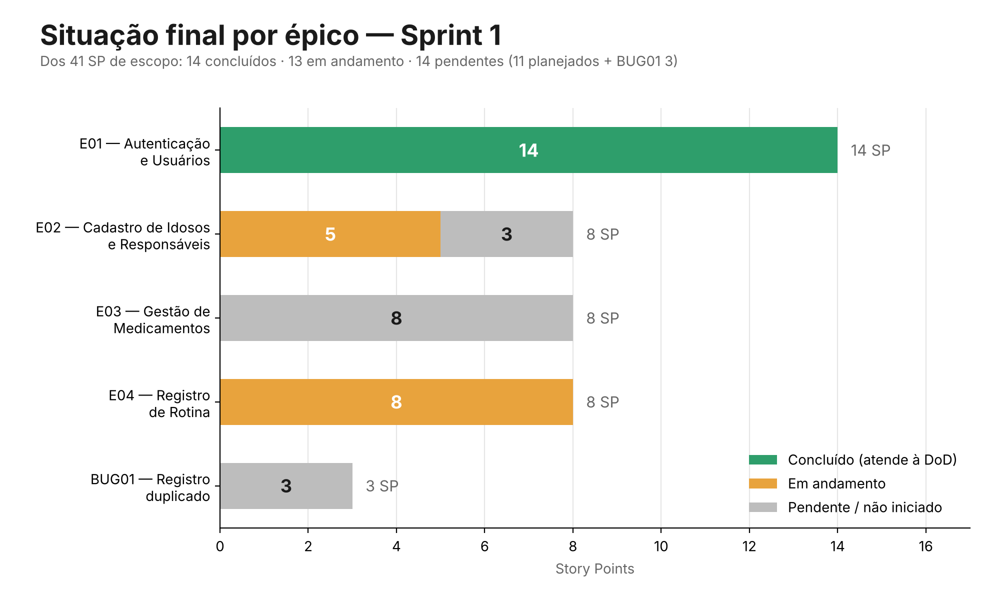
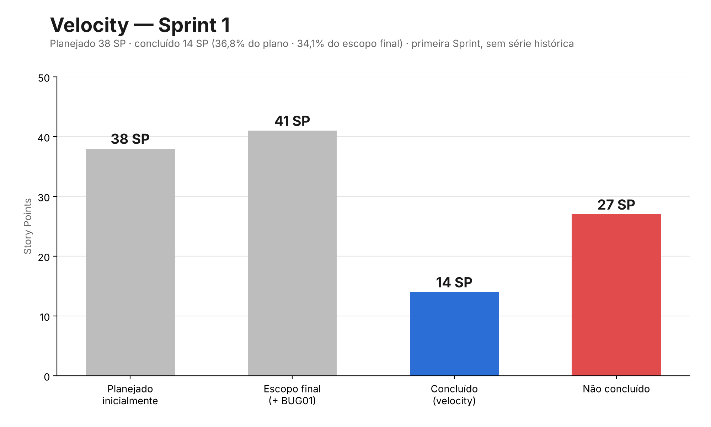
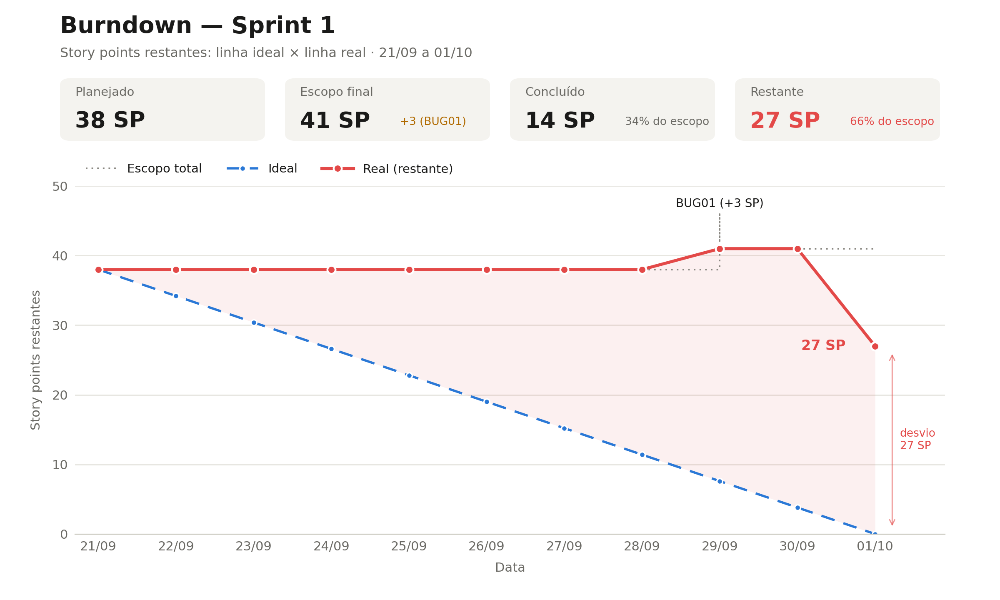

# Entrega 5 — Análise de Métricas e Qualidade do Processo

**Projeto:** Acolher+ (sistema de gestão para lar de idosos)
**Sprint analisada:** Sprint 1 — 21/09/2026 a 01/10/2026 (10 dias)
**Repositório:** https://github.com/heloisadml/prs-acolher-mais
**Quadro de acompanhamento:** https://github.com/users/heloisadml/projects/1

## Integrantes

| Integrante | Papel na Sprint 1 |
|---|---|
| Danylo Vieira de Melo Barros Falcão | Product Owner |
| Heloisa de Moraes Lira | Integrante da equipe |
| Mileni Savily de Souza Alves | Scrum Master |
| Sandrine de Araújo Azevedo | Integrante da equipe |

---

## 1. Resumo da análise

- Foram planejados **38 Story Points (SP)**; durante a Sprint o BUG01 adicionou **3 SP**, e o escopo final foi de **41 SP**.
- Foram concluídos **14 SP**, todos do épico E01 — Autenticação e Usuários. A **velocity da Sprint 1 é 14 SP**.
- A taxa de conclusão foi de **36,84%** sobre o plano inicial e de **34,15%** sobre o escopo final.
- O planejamento previu **2,7 vezes** a capacidade que a equipe demonstrou (38 ÷ 14).
- O burndown real ficou **acima da linha ideal durante toda a Sprint**: permaneceu em 38 SP por 8 dias, subiu para 41 SP com o BUG01 e só caiu para 27 SP no último dia.
- Os principais gargalos foram: escopo acima da capacidade, trabalho aberto em paralelo sem conclusão, dependências entre épicos, mudança de requisito e bug no mesmo épico (E02) e conclusão formal atrasada pela documentação.
- A conclusão central é que **o problema principal da Sprint foi de planejamento e de fluxo de trabalho, e não de falta de esforço**: nos 4 primeiros dias a equipe entregou 14 SP, um ritmo próximo do ideal, e depois nenhuma nova história foi concluída.

---

## 2. Métricas coletadas

| Métrica | Como foi calculada | Valor | Onde está registrada |
|---|---|---:|---|
| SP planejados | Soma das estimativas das histórias selecionadas no Planning | 38 SP | `sprint-backlog.md` |
| SP adicionados na Sprint | Estimativa do BUG01 | 3 SP | `sprint-backlog.md`, `change-management.md` |
| Escopo final | Planejado + adicionado | 41 SP | `metrics.md` |
| SP concluídos | Histórias que atendem integralmente à Definition of Done (DoD) | 14 SP | `metrics.md`, `definition-of-done.md` |
| Velocity | Soma dos SP concluídos | 14 SP | `metrics.md` |
| Taxa de conclusão (plano inicial) | 14 ÷ 38 × 100 | 36,84% | `metrics.md` |
| Taxa de conclusão (escopo final) | 14 ÷ 41 × 100 | 34,15% | `metrics.md` |
| SP restantes ao fim | 41 − 14 | 27 SP | `metrics.md` |
| Burndown (SP restantes por dia) | Registro diário de trabalho restante | 38 → 41 → 27 | `metrics.md` e `images/burndown-sprint-1.png` |
| Histórias concluídas | Histórias Done ÷ histórias planejadas | 4 de 10 (40%) | `sprint-review.md` |
| Crescimento de escopo | 3 ÷ 38 × 100 | 7,9% | derivada de `metrics.md` |
| Relação planejado ÷ velocity | 38 ÷ 14 | 2,7× | derivada de `metrics.md` |
| Impedimentos registrados | Contagem no registro de execução | 5 | `sprint-execution.md` |
| Mudanças de requisito | Gestão de mudança | 1 (29/09) | `change-management.md` |
| Bugs abertos / corrigidos | Registro do backlog | 1 / 0 | `sprint-backlog.md` |

**Regra de contagem.** Uma história só entra na velocity quando atende integralmente à Definition of Done (critérios de aceitação, implementação, testes, validação, revisão e integração quando aplicáveis, ausência de erro crítico conhecido e documentação atualizada). Histórias parciais contam zero. Os 4 itens contabilizados (issues #8, #9, #10 e #11) têm os critérios marcados no GitHub.

**Escala de estimativa.** Story Points em escala relativa baseada em Fibonacci, considerando complexidade, esforço e incerteza.

---

## 3. Dados da Sprint

### 3.1 Escopo planejado e resultado final

| Item | História | SP | Resultado final |
|---|---|---:|---|
| E01-US01 | Cadastro de Administrador | 3 | **Concluída** |
| E01-US02 | Login de Administrador | 3 | **Concluída** |
| E01-US03 | Login de Cuidador | 3 | **Concluída** |
| E01-US04 | Criação de contas para Cuidadores e Familiares | 5 | **Concluída** |
| E02-US01 | Cadastro de novo idoso | 5 | Em andamento |
| E02-US03 | Listagem de idosos | 3 | Pendente |
| E03-US01 | Cadastro de medicamentos | 5 | Pendente |
| E03-US02 | Consulta de medicamentos por horário | 3 | Pendente |
| E04-US01 | Checklist diário de higiene | 5 | Em andamento |
| E04-US02 | Registro das refeições | 3 | Em andamento |
| **Total planejado** | | **38** | **14 concluídos** |
| BUG01 | Registro de idosos duplicado (incluído em 29/09) | 3 | Pendente |
| **Escopo final** | | **41** | |

Distribuição dos 38 SP planejados ao fim da Sprint: **14 SP concluídos (36,8%)**, **13 SP em andamento (34,2%)** e **11 SP sem início efetivo (28,9%)**, com valores arredondados.

### 3.2 Linha do tempo (registro de execução)

| Data | Evento | Impedimento registrado |
|---|---|---|
| 21/09 | Sprint iniciada | — |
| 22/09 | Início do E01-US01 | — |
| 23/09 | Início de E01-US02 e E01-US03 | Alinhar regras de acesso entre perfis |
| 24/09 | Início do E01-US04 | Dependência das regras de autenticação |
| 25/09 | E01 validado funcionalmente; documentação pendente | Documentação pendente |
| 26/09 | Início do E02-US01 | Definir informações obrigatórias do cadastro |
| 27/09 | Início do E04-US01 | — |
| 28/09 | Início do E04-US02 | — |
| 29/09 | **BUG01 identificado** e mudança de requisito do E02-US01 | Correção não iniciada |
| 30/09 | Revisão e reorganização das prioridades | Capacidade restante insuficiente |
| 01/10 | E01 atende integralmente à DoD; Sprint Review e Retrospectiva | — |

### 3.3 Mudanças durante a Sprint

1. **BUG01 (+3 SP, 29/09).** Ao registrar um idoso e atualizar a página, o registro aparecia duplicado. Foi registrado no Sprint Backlog, mas a correção não foi iniciada.
2. **Mudança de requisito do E02-US01 (29/09).** O primeiro contato de emergência passou a ser obrigatório no cadastro inicial do idoso. A equipe aceitou a mudança e **manteve os 5 SP**, registrando o aumento de complexidade para planejamentos futuros (`change-management.md`).

---

## 4. Análise da velocity

**Velocity da Sprint 1: 14 SP.** Como só houve uma Sprint, não existe série histórica e portanto não é possível calcular média, tendência ou variação entre Sprints. O valor é uma **referência inicial de capacidade**, como a própria equipe decidiu na Review.

**O que o dado revela:**

- **O plano foi 2,7 vezes maior que a capacidade observada.** A equipe planejou 38 SP e entregou 14.
- **Tudo o que foi entregue vem de um único épico.** Os 14 SP são as quatro histórias do E01, que são a base do sistema (autenticação e contas) e tinham menos dependências de outras funcionalidades.
- **A velocity é conservadora por construção.** Pela regra da DoD, histórias em andamento contam zero. Os 13 SP em andamento (E02-US01, E04-US01 e E04-US02) não aparecem na velocity, embora representem trabalho já feito.
- **A estimativa não foi calibrada.** A retrospectiva registra que a estimativa inicial não tinha dados de Sprints anteriores como referência. A velocity de 14 SP passa a ser essa referência.

**Implicação para o planejamento.** Se a capacidade se mantiver, os 27 SP que sobraram (E02-US01 5, E02-US03 3, E03-US01 5, E03-US02 3, E04-US01 5, E04-US02 3 e BUG01 3) ocupariam sozinhos **cerca de duas Sprints** (27 ÷ 14 ≈ 1,9), sem contar histórias novas. Essa é uma projeção, e não um dado medido.

---

## 5. Análise do burndown

### 5.1 Dados

| Dia | Data | SP restantes (real) | SP restantes (ideal) | Evento |
|---|---|---:|---:|---|
| Início | 21/09 | 38 | 38,0 | Início da Sprint |
| 1 | 22/09 | 38 | 34,2 | E01 em desenvolvimento |
| 2 | 23/09 | 38 | 30,4 | Autenticação em desenvolvimento |
| 3 | 24/09 | 38 | 26,6 | Continuidade do E01 |
| 4 | 25/09 | 38 | 22,8 | E01 validado; documentação pendente |
| 5 | 26/09 | 38 | 19,0 | E02-US01 em andamento |
| 6 | 27/09 | 38 | 15,2 | E04-US01 em andamento |
| 7 | 28/09 | 38 | 11,4 | E04-US02 em andamento |
| 8 | 29/09 | 41 | 7,6 | BUG01 adicionado (+3) |
| 9 | 30/09 | 41 | 3,8 | Revisão dos itens em andamento |
| Final | 01/10 | 27 | 0 | E01 atende à DoD (−14) |

A linha ideal considera os 38 SP iniciais e uma queda uniforme de 3,8 SP por dia.

### 5.2 Interpretação

O gráfico tem **três fases**:

1. **Patamar plano (21/09 a 28/09):** 38 SP por 8 dias seguidos. Isso **não significa que nada foi feito**. O registro de execução mostra que o E01 foi desenvolvido e validado até 25/09. Os pontos não caíram porque a DoD só desconta SP de histórias totalmente concluídas, e a documentação do E01 ainda estava pendente.
2. **Aumento de escopo (29/09):** o BUG01 elevou o restante a 41 SP e o desvio em relação à linha ideal chegou a **37,2 SP em 30/09** (41 contra 3,8).
3. **Queda final (01/10):** o desconto dos 14 SP do E01 de uma só vez, deixando **27 SP** (desvio final de 27 SP em relação à linha ideal).

**O que isso mostra sobre o processo:**

- **O burndown ficou "cego" durante a Sprint.** Como o desconto só acontece ao final, o desvio não era visível no meio da Sprint, que é justamente quando poderia ser corrigido.
- **O E01 estava funcionalmente pronto em 25/09 e só foi contabilizado em 01/10.** Foram 6 dias entre a validação e o fechamento formal. A pendência de documentação é o fator registrado nessa diferença.
- **O ritmo foi bom quando o foco foi único.** Entre 22/09 e 25/09, a equipe concluiu funcionalmente 14 SP em 4 dias, cerca de **3,5 SP/dia**, próximo da inclinação ideal de 3,8 SP/dia. De 26/09 a 01/10, nenhuma nova história foi concluída.
- **A queda abrupta no último dia é um indício de planejamento por "tudo ou nada".** Com histórias de 3 a 5 SP e nenhum acompanhamento intermediário, o gráfico só registra o resultado no fim.

---

## 6. Análise do desempenho

Cruzando as métricas:

| Observação | Dado que sustenta |
|---|---|
| A equipe entregou a base do sistema, mas nenhuma funcionalidade de negócio ficou pronta | Só o E01 (autenticação e contas) foi concluído; E02, E03 e E04 não chegaram à DoD |
| Havia muito trabalho aberto e pouco fechado | Ao fim, 3 histórias (13 SP) em andamento e 3 (11 SP) sem início, contra 4 concluídas |
| O desempenho foi diferente nas duas metades da Sprint | 14 SP concluídos em 22–25/09; 0 SP concluídos em 26/09–01/10 |
| O escopo cresceu durante a Sprint | +3 SP (7,9%) do BUG01 e aumento de complexidade do E02-US01 sem reestimativa |
| O épico E02 concentrou os problemas | BUG01, mudança de requisito, dados obrigatórios indefinidos e dependência de outros épicos |
| O E03 não chegou a ser iniciado de forma efetiva | Status "To Do" no quadro; retrospectiva confirma |

---

## 7. Gargalos identificados

| # | Gargalo | Evidência nos dados | Causas e fatores relacionados | Efeito no resultado |
|---|---|---|---|---|
| G1 | **Escopo planejado acima da capacidade** | 38 SP planejados contra 14 entregues (2,7×); impedimento de 30/09; retrospectiva | Primeira Sprint, sem velocity anterior; estimativa sem dados históricos; 4 épicos selecionados de uma vez; sem reserva para imprevistos | 27 SP não concluídos; taxa de 36,84% |
| G2 | **Muito trabalho em paralelo sem conclusão (WIP alto)** | 3 histórias em andamento (13 SP) ao fim; 26, 27 e 28/09 iniciam E02-US01, E04-US01 e E04-US02 em sequência, sem concluir nenhuma | Quatro pessoas distribuídas em vários épicos ao mesmo tempo; início de novos itens antes de fechar os anteriores | Nenhum SP adicional concluído de 26/09 a 01/10 |
| G3 | **Dependências entre histórias e épicos** | Impedimentos de 23/09 e 24/09; Review indica que medicamentos e rotina dependem do cadastro de residentes | E03 e E04 dependem do cadastro do E02, que ainda estava em andamento; regras de acesso por perfil tinham que ser alinhadas antes das contas (E01-US04) | E03 não iniciado; E04 desenvolvido sem a base de residentes consolidada |
| G4 | **Mudança de requisito e bug no mesmo épico, no mesmo dia** | 29/09: BUG01 (+3 SP) e obrigatoriedade do contato de emergência no E02-US01 | Dados obrigatórios do cadastro não estavam definidos no início (impedimento de 26/09); a mudança foi aceita sem reestimar (5 SP mantidos) | E02 virou ponto crítico; o bug ficou sem correção e o escopo real cresceu mais do que os +3 SP registrados |
| G5 | **Fechamento formal atrasado pela documentação** | E01 validado em 25/09 e só conta em 01/10; burndown plano por 8 dias | A documentação foi tratada como etapa final, e a DoD a exige para contar SP; sem acompanhamento intermediário dos itens | Baixa visibilidade do progresso real durante a Sprint; desvio não detectado cedo |
| G6 | **Ausência de reserva e de acompanhamento frequente** | Bug entrou sem capacidade reservada; retrospectiva cita acompanhamento pouco frequente | Planejamento sem margem para correções; a retrospectiva aponta a necessidade de acompanhar a Sprint com mais frequência | Imprevisto absorvido sem replanejamento explícito até 30/09 |

**Observação sobre as causas.** As causas acima são **fatores sustentados pelos registros do grupo** (execução, review, retrospectiva, gestão de mudança). Elas não foram medidas individualmente: com uma única Sprint, não é possível separar quanto de cada gargalo contribuiu para o resultado.

---

## 8. Melhorias

### 8.1 Melhorias aplicadas durante a Sprint 1

| Melhoria | Evidência | Efeito observado |
|---|---|---|
| **Definition of Done única e regra de contagem na velocity** | `definition-of-done.md`; issues #8 a #11 com critérios marcados | A velocity de 14 SP é verificável e não inclui trabalho parcial; torna a medição objetiva (efeito colateral: burndown plano) |
| **Gestão de mudança formal para o requisito do E02-US01** | `change-management.md` (29/09) | Impacto analisado em backlog, tarefa técnica, testes e estimativa; rastreabilidade preservada (E02-US04 reformulada) |
| **Registro do BUG01 no backlog com estimativa e critérios de correção** | `sprint-backlog.md`; issue #7 | O trabalho extra ficou visível no burndown (+3 SP), em vez de ser absorvido sem registro |
| **Reorganização das prioridades em 30/09** | `sprint-execution.md` | Itens em andamento e pendentes reclassificados; decisões da Review baseadas nesse estado |
| **Padronização do registro de trabalho** | Templates de épico, história, tarefa e bug em `.github/ISSUE_TEMPLATE` | Itens rastreáveis por issue, com critérios de aceitação e DoD |

### 8.2 Melhorias definidas para a Sprint 2 (ainda não aplicadas)

A retrospectiva de 01/10 definiu as ações abaixo. Elas decorrem diretamente dos gargalos da seção 7:

| Ação (retrospectiva) | Gargalo tratado | Responsável |
|---|---|---|
| Reavaliar a quantidade de SP planejados, usando a velocity de 14 SP como referência | G1 | Equipe |
| Priorizar a conclusão do cadastro de residentes antes de abrir novos itens | G2, G3 | Equipe |
| Priorizar a correção do BUG01 | G4 | Danylo Falcão |
| Identificar dependências entre histórias no Planning | G3 | Equipe |
| Reservar capacidade para bugs e imprevistos | G4, G6 | Equipe |
| Atualizar o GitHub Project durante a Sprint e acompanhar com mais frequência | G5, G6 | Equipe |

Também existe a proposta de fluxo em `processo-equipe-ampliada.md`, com estados de Code Review, Testes e Validação do PO e um fluxo próprio para bugs (Novo, Triagem, Em correção, Em teste, Fechado). Ela foi escrita para uma equipe maior e **não foi usada na Sprint 1**.

### 8.3 Impacto das melhorias

**O que já pode ser afirmado (Sprint 1):**

- A DoD e a gestão de mudança deixaram o processo **mais confiável e rastreável**: todos os 14 SP têm evidência, e a mudança de 29/09 tem decisão e impacto documentados.
- O registro explícito do BUG01 permitiu enxergar o crescimento de escopo (7,9%).
- A DoD rígida também teve um **custo**: o progresso real do E01 só apareceu no último dia. A melhoria foi positiva para a qualidade da medição e negativa para o acompanhamento diário.

**O que ainda não pode ser afirmado:** o impacto das ações da Sprint 2 sobre o desempenho. Com uma só Sprint não há como comparar antes e depois, e dizer que "a velocity vai melhorar" seria uma suposição. Para a Sprint 2, os indicadores abaixo permitem verificar o efeito:

| Indicador | Sprint 1 (base) | O que indicaria melhora |
|---|---:|---|
| SP planejados ÷ velocity de referência | 2,7× | Próximo de 1,0× |
| Taxa de conclusão | 36,84% | Aumento em relação à base |
| Histórias abertas ao mesmo tempo ao fim da Sprint | 3 | Redução |
| SP adicionados durante a Sprint | 3 (7,9%) | Dentro da reserva prevista |
| Dias entre validação funcional e conclusão pela DoD | 6 | Redução |
| Bugs abertos ao fim da Sprint | 1 | Zero |

---

## 9. Relatório de qualidade do processo

### 9.1 Indicadores

| Aspecto | Resultado | Avaliação |
|---|---|---|
| Previsibilidade do planejamento | 36,84% do plano concluído; plano 2,7× a capacidade | **Crítico** |
| Estabilidade do escopo | +7,9% por bug e 1 mudança de requisito sem reestimar | **Atenção** |
| Fluxo de trabalho | 3 histórias abertas e nenhuma concluída de 26/09 a 01/10 | **Atenção** |
| Rigor da definição de pronto | 4 de 4 histórias contadas com DoD comprovada; parciais não contabilizadas | **Adequado** |
| Rastreabilidade | Itens com issue, critérios, decisão de mudança e links no repositório | **Adequado** |
| Tratamento de mudanças | Impacto analisado e decisão registrada | **Adequado** |
| Visibilidade do progresso | Burndown plano até o fim; desvio só visível no encerramento | **Atenção** |
| Qualidade do produto | 1 bug aberto (BUG01); sem erro crítico conhecido nas histórias concluídas | **Atenção** |
| Aprendizado e melhoria contínua | Review e retrospectiva realizadas, com 6 ações definidas | **Adequado** |

Essa classificação é uma avaliação nossa, baseada nos dados das seções anteriores.

### 9.2 Pontos fortes

- Medição objetiva, com DoD aplicada de forma consistente.
- Documentação completa da Sprint (planejamento, execução, review, retrospectiva, métricas e gestão de mudança).
- Ritmo alto e previsível enquanto o foco foi um único épico (≈ 3,5 SP/dia).
- Resposta estruturada a imprevistos (bug e mudança de requisito registrados e analisados).

### 9.3 Pontos de atenção

- Planejamento sem referência de capacidade e sem reserva.
- Trabalho em paralelo demais, com dependências entre épicos não tratadas no Planning.
- Progresso intermediário invisível no burndown.
- Estimativa não revista após o aumento de complexidade do E02-US01.

### 9.4 Recomendações para a Sprint 2

1. **Planejar em torno de 14 SP**, com uma pequena reserva para bugs (o BUG01 representou 3 SP).
2. **Começar pelo cadastro de residentes e pelo BUG01** (E02-US01, E02-US03 e BUG01 somam 11 SP), já que medicamentos e rotina dependem deles.
3. **Limitar histórias abertas ao mesmo tempo** e só abrir uma nova quando outra for concluída.
4. **Acompanhar o progresso por tarefas técnicas** (T01 a T10), além das histórias, para o burndown mostrar o avanço antes do fechamento pela DoD. As histórias seguem contando na velocity só ao atender a DoD.
5. **Atualizar a documentação junto com a implementação**, e não ao final.
6. **Reestimar histórias quando o requisito mudar.**

### 9.5 Conclusão

A Sprint 1 entregou a base de autenticação e usuários com qualidade comprovada (14 SP) e deixou duas lições claras: o plano foi muito maior que a capacidade (2,7×) e o trabalho foi aberto em paralelo sem ser fechado. Essas conclusões se apoiam nos registros da Sprint, e a ação mais importante da Sprint 2 é **planejar com base na velocity de 14 SP e concluir antes de abrir novos itens**.

---

## 10. Limitações dos dados

- **Uma única Sprint:** não há série histórica para tendência ou comparação, e o efeito das melhorias da Sprint 2 ainda não pode ser medido.
- **Burndown reconstruído:** conforme `metrics.md`, foi montado a partir do histórico do quadro, do Sprint Backlog, do registro de execução e das issues, e não coletado dia a dia durante a Sprint. Esse é um ponto a melhorar na Sprint 2.
- **Registro diário resumido:** o diário mostra a situação ao final de cada dia, sem horas de esforço por pessoa. Por isso, causas como carga individual não foram analisadas.
- **Estimativas das tarefas técnicas (T01 a T10)** não foram usadas nas métricas; os cálculos usam as estimativas das histórias.

## Referências (pasta `docs/sprint-1`)

- [Sprint Planning](sprint-planning.md)
- [Sprint Backlog](sprint-backlog.md)
- [Definition of Done](definition-of-done.md)
- [Registro da Execução](sprint-execution.md)
- [Sprint Review](sprint-review.md)
- [Retrospectiva](retrospective.md)
- [Métricas](metrics.md)
- [Gestão de Mudança](change-management.md)
- [Processo — Equipe Ampliada](../processo-equipe-ampliada.md)
